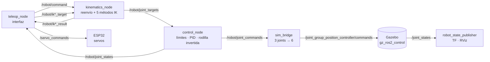

# Robot Muñeco — Arquitectura ROS 2 optimizada

Muñeco bípedo de **2 piernas × 3 GDL** (cadera roll, cadera pitch, rodilla) con ROS 2 Humble, simulación en Gazebo y control por interfaz gráfica.

Este repositorio contiene la **optimización de la arquitectura ROS 2 del muñeco (Entregable 1, corte 3)**: recuento de paquetes, nodos y tópicos; eliminación de módulos de los cortes 1 y 2; unificación de nodos redundantes, e integración del muñeco con Gazebo.

**Responsable:** Santiago Sarria Arcila (2215465) · Robótica, Universidad Autónoma de Occidente
**Código base:** repositorio del equipo [`juanperezpomar-source/Bipedo_Mu-eco`](https://github.com/juanperezpomar-source/Bipedo_Mu-eco) y workspace `muneco_ws` (Gazebo).

---

## 🌿 Ramas

| Rama | Contenido |
|---|---|
| `main` | Código original del muñeco, tal como estaba antes de la optimización. |
| `feature/optimizacion-arquitectura-muneco` | **Código optimizado** (7 commits, uno por paquete). |

Ver todos los cambios juntos: **[main...feature/optimizacion-arquitectura-muneco](../../compare/main...feature/optimizacion-arquitectura-muneco)**

---

## 📊 Resultado

| Métrica | Antes | Después |
|---|---|---|
| Nodos corriendo con una pierna | 11 | **6** |
| Procesos de cinemática | 6 | **1** |
| RAM de la cinemática | 417,9 MB | **69,9 MB** |
| RAM total de los nodos del proyecto | 645,9 MB | **294,0 MB** |
| Ejecutables (entry points) | 11 | **5** |
| Archivos launch | 10 | **4** |
| Advertencias de `colcon build` | 1 | **0** |
| Mover una pierna en Gazebo desde la interfaz | no | **sí** (error 0,000 rad) |

Medido con la arquitectura en ejecución (una pierna, sin RViz).

---

## 🔧 Qué se cambió

### `robot_kinematics` — 6 nodos → 1
- **Unificación:** `ik_node`, `ik_des_node`, `ik_geom_node`, `ik_newton_node`, `ik_grad_node` y `kinematics_node` pasan a ser un solo **`kinematics_node`**. Los cinco nodos IK eran el mismo código copiado; solo cambiaban la función de cinemática inversa y el prefijo del tópico.
- **Tabla `SOLVERS`:** cada método (algebraico, desacople, geométrico, Newton-Raphson, gradiente descendente) es una entrada de la tabla, y el nodo crea sus tópicos en un bucle.
- **Mismos tópicos:** `/robot/ik*_target` → `/robot/ik*_result` no cambian, así que `teleop_node` no se tocó. Se conserva el reflejo de *z* para la pierna derecha.
- **Ejecutor multihilo:** el reenvío `/robot/command → /robot/joint_targets` no se bloquea mientras el gradiente itera (~1 s).
- **Eliminados:** `kinem_leg_gen.py` (FK duplicada, nadie la importaba) y `kinem_leg_rtb.py` (script de prueba que dependía de `roboticstoolbox` sin declararlo).

### `robot_bringup` — un launch por modo
- **`bringup_pierna.launch.py leg:=izq|der`** reemplaza a `bringup_der` y `bringup_izq`, que eran el mismo archivo (~990 líneas).
- **`bringup_muneco.launch.py`** (nuevo): Gazebo más la arquitectura completa. Desde la interfaz se mueve la pierna simulada.
- **Eliminado:** `test_injector_node`, un esqueleto del corte 1 que competía con el teleop en `/robot/command`.

### `robot_description` — un solo modelo
- **Modelo único** `urdf/urdf_muneco/muneco_bipedo_v3.urdf`: Z hacia arriba y bloque `ros2_control` con `gz_ros2_control`. Es el mismo archivo para RViz y Gazebo.
- **Reemplaza** al URDF V3 anterior, que estaba exportado con Y hacia arriba y necesitaba un xacro que lo rotara.
- **Eliminados:** los URDF y mallas por pata V2.x (son del bípedo, no del muñeco) y 7 launch de visualización y Gazebo Classic.
- **Nuevo:** `display.launch.py` (RViz con Fixed Frame `Base_link`).

### `robot_simulation` — Gazebo funcionando
- **`launch/gazebo_muneco.launch.py`:** abre Gazebo, hace el spawn y carga los controladores **en cadena por eventos**, sin esperas fijas de 8 y 10 s. Funciona en Fortress (Humble) y Harmonic (Jazzy).
- **`config/controllers.yaml`:** `joint_group_position_controller` con las 6 articulaciones. Se movió aquí porque en Jazzy una ruta que contiene `robot_description` hace que los controladores no carguen.
- **`sim_bridge` corregido:** enviaba 3 valores a un controlador de 6 joints y Gazebo los descartaba. Ahora ubica cada valor por nombre de joint.

### `robot_control`
- **Parámetros:** se leen una vez y se validan con `ros2 param set`. Antes el bucle de 50 Hz hacía 150 lecturas por segundo.
- **Eliminados:** `balance.py` y `sensor_processing.py`, que nadie importaba.
- **`motor_control.py`** se integra en `pid_controllers.py`.
- **Se conserva** la inversión del *Knee Pitch* y todos los comentarios originales.

### Limpieza
- **Eliminados:** `prueba.txt`, `tests/Hola_mundo.py` y `robot_teleop/forward_kinematics.py` (DH antiguo sin uso).
- **Nuevo:** `scripts/launch_gazebo_muneco.sh` (compila y abre Gazebo desde cualquier carpeta).

La justificación detallada de cada cambio está en [`docs/arquitectura/OPTIMIZACION_ARQUITECTURA.md`](docs/arquitectura/OPTIMIZACION_ARQUITECTURA.md) y el detalle de nodos y tópicos en [`ros2_ws/src/ARCHITECTURE.md`](ros2_ws/src/ARCHITECTURE.md) (rama `feature/optimizacion-arquitectura-muneco`).

---

## 🗺️ Arquitectura



---

## 🚀 Cómo correrlo (rama `feature/optimizacion-arquitectura-muneco`)

```bash
git checkout feature/optimizacion-arquitectura-muneco
cd ros2_ws
source /opt/ros/humble/setup.bash
colcon build
source install/setup.bash
```

| Qué | Comando |
|---|---|
| Muñeco en Gazebo + interfaz (pierna izquierda) | `ros2 launch robot_bringup bringup_muneco.launch.py` |
| Igual, pierna derecha | `ros2 launch robot_bringup bringup_muneco.launch.py leg:=der` |
| Solo Gazebo | `ros2 launch robot_simulation gazebo_muneco.launch.py` |
| Una pierna en RViz | `ros2 launch robot_bringup bringup_pierna.launch.py leg:=izq` |
| Solo el modelo | `ros2 launch robot_description display.launch.py` |
| Todo en un paso (compila y abre Gazebo) | `./scripts/launch_gazebo_muneco.sh` |

Mover la pierna sin la interfaz (con `bringup_muneco.launch.py teleop:=false`):

```bash
ros2 topic pub --once /robot/command robot_interfaces/msg/RobotCommand \
  "{mode: 0, position: [0.3, 0.4, 0.5], velocity: [0.0, 0.0, 0.0]}"
ros2 topic echo /joint_states   # Left: 0.3, 0.4, -0.5 (rodilla invertida)
```

Paro de emergencia: `ros2 topic pub --once /robot/e_stop std_msgs/msg/Bool "{data: true}"`

---

## ✅ Verificación

- **Compilación:** `colcon build` compila los 8 paquetes sin advertencias.
- **Grafo:** 6 nodos por pierna; los mismos 24 tópicos de antes.
- **Cinemática inversa:** 15/15 respuestas idénticas a llamar directamente a cada función, más la pierna derecha con reflejo de *z*.
- **Límites:** cambiados en vivo con `ros2 param set`; una lista con tamaño inválido se rechaza.
- **Gazebo:** `/robot/command [0.3, 0.4, 0.5]` dejó los joints izquierdos en `[0.300, 0.400, −0.500]` con error 0,000 rad, y la pierna derecha quieta.

Probado en ROS 2 Jazzy + Gazebo Harmonic. En el laboratorio (Humble + Fortress) hay que confirmar con los mismos comandos.

---

## 📌 Pendiente (siguiente actividad)

- **UNO Q e IMU:** comunicación con Arduino UNO Q (receptor iA8 para servos) e IMU BNO085.
- **Seguridad del teleop:** hoy publica `/servo_commands` directo, sin pasar por el e-stop ni los límites de `control_node`.
- **Límite de cadera roll:** alinear control (−0,2618 rad), interfaz (0°) y URDF (−0,1396 rad).
- **Modo PID** (`verify_mode=False`): es un modelo de prueba; reemplazarlo por el control real.
- **Caminata:** generador de pasos para las dos piernas (meta: 6 de noviembre).

---

## 📁 Estructura

```text
Robot_Muneco/
├── ros2_ws/src/
│   ├── robot_interfaces/     mensajes (RobotCommand, JointTarget, JointState, IK*)
│   ├── robot_description/    URDF del muñeco + mallas + display.launch.py
│   ├── robot_kinematics/     kinematics_node (reenvío + 5 métodos IK)
│   ├── robot_control/        control_node + PID
│   ├── robot_simulation/     Gazebo (launch + controllers.yaml) + sim_bridge
│   ├── robot_teleop/         interfaz gráfica
│   ├── robot_serial_bridge/  puente serie con la ESP32
│   └── robot_bringup/        bringup_pierna y bringup_muneco
├── firmware/                 ESP32 (servos) y control_pata sin ROS
├── scripts/                  launch_gazebo_muneco.sh
├── docs/                     arquitectura y justificación del entregable
├── matlab/  tests/
```

No se suben `ros2_ws/build/`, `ros2_ws/install/` ni `ros2_ws/log/` (ver `.gitignore`).
